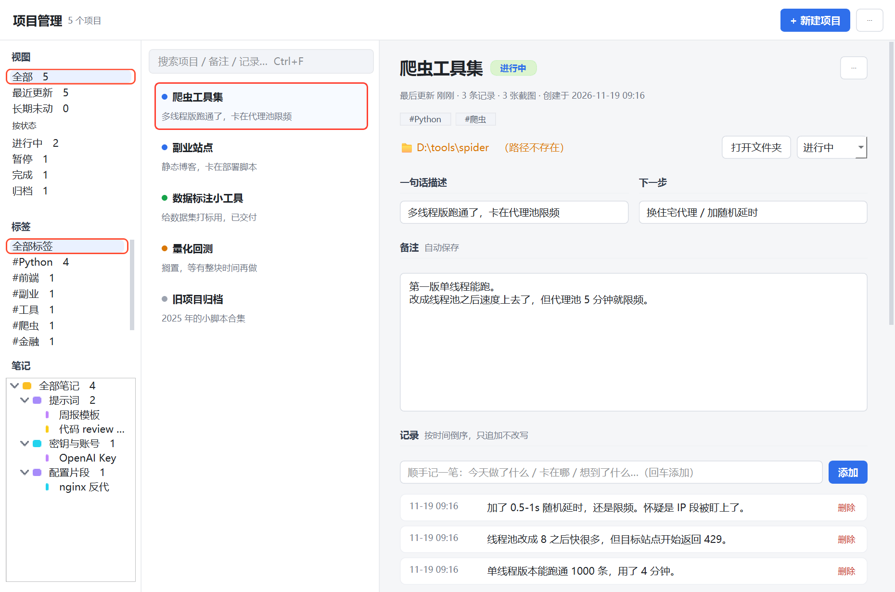

# SavePoint

[](LICENSE)

**A local-first memory aid for your side projects.**
Write one line while you work, and months later you can still tell what you were
doing, where you got stuck, and what came next.

Windows 10/11 · Python 3.10+ · PySide6 · everything stays on your machine.



---

## 它解决什么问题

项目一多、时间一长，你完全忘了当时在做什么、为什么那么做、卡在哪。

SavePoint 只做一件事：**让你在做事的时候顺手留个存档点**，三个月后翻出来能立刻
接上上下文。它不是待办工具，也不是笔记软件的大而全。

## 功能

> 详细的场景化说明见 [FEATURES.md](savepoint/docs/FEATURES.md)。

**项目卡片** —— 名称、状态（进行中 / 暂停 / 完成 / 归档）、标签、目录、一句话描述、
下一步。目录失效会标黄提醒。

**追加式记录** —— 每个项目一条按时间排列的记录流，回车就存，只增不改（可以编辑错别字）。
最后看到的是完整过程，而不是一句结论。

**截图时间线** —— 拖图片进来、`Ctrl+V` 粘贴、或者点「截图」框选屏幕区域，自动生成
缩略图并按时间排好。同一张图会自动去重。

**回顾视图** —— 左侧「最近更新」「长期未动」两个视角。30 天没动的进行中项目会挂
一个橙色标记。

**全局搜索** `Ctrl+K` —— 一个框搜项目、记录、笔记、截图说明，回车直达。

**活动流** —— 把所有项目的记录合并成按日期分组的时间线，回答“我这周到底干了啥”。

**笔记** —— 独立的分区/文档树，正文边写边存。深色窗口，和主界面区分开。

**快速记录** —— `Ctrl+Alt+N` 在任意程序里唤起小窗，选项目、打字、回车，记完就关。

**保险起见** —— 删除先进回收站（30 天）；启动时自动滚动备份；「⋯」→「从备份恢复」
可以选一份快照回滚，回滚前还会先把当前数据另存一份。

## 安装

**方式一：下载便携版**

从 [Releases](../../releases) 下载 `SavePoint-<版本>-portable.zip`，解压到任意可写目录，
双击 `SavePoint.exe`。不写注册表，整个文件夹可以拷到别的机器。

> ⚠️ 不要解压到 `C:\Program Files` 这类受保护目录，程序需要在旁边写数据。
> 如果解压后「打开文件夹」没反应、弹窗提示「低完整性」，说明该目录被系统标成了
> 受限目录 —— 把 zip 换到一个普通目录（例如 `C:\Apps\SavePoint`）解压即可，或按
> 弹窗里的提示执行一次 `icacls` 命令。

**方式二：从源码运行**

```bat
setup.bat
run.bat
```

`setup.bat` 会创建 `.venv` 并安装依赖（`PySide6-Essentials`、`Pillow`），
缓存和临时文件都留在项目目录里。

## 数据放在哪

默认是**程序（或源码）目录旁的 `savepoint-data\`**：

```
savepoint-data\
├── projects.db          # SQLite：项目、记录、截图索引、笔记
├── screenshots\         # 原图
├── thumbnails\          # 缩略图
├── backups\             # 自动快照 zip
└── savepoint.log        # 日志
```

设置文件是程序目录旁的 `savepoint.ini`。想换位置，用设置窗口改，或设环境变量
`SAVEPOINT_DATA_DIR`。

**备份就是拷走整个 `savepoint-data` 目录**，换机器时连同 `savepoint.ini` 一起复制即可。

## 快捷键

| 快捷键 | 作用 |
|--------|------|
| `Ctrl+Alt+N` | 全局：唤起快速记录（可在设置里改） |
| `Ctrl+K` | 全局搜索 |
| `Ctrl+N` | 新建项目 |
| `Ctrl+F` | 聚焦列表搜索框 |
| `Ctrl+Shift+V` | 打开笔记 |
| `Ctrl+Shift+B` | 立即备份 |
| `Ctrl+Shift+T` | 打开回收站 |
| `Enter` | 添加记录 / 保存快速记录 |
| 截图区聚焦时 `Ctrl+V` | 粘贴剪贴板图片 |

## 隐私

- 不联网：程序没有任何网络请求（截图与数据都在本地）
- 不收集：没有遥测、没有统计、没有账号
- 笔记是**明文**存储，别把真正不能落盘的东西放进去
- 数据目录里的一切都归你，删掉整个目录就是彻底清除

## 从源码构建

```bat
.venv\Scripts\python.exe scripts\build.py
```

产物：

```
dist\SavePoint\                        # 双击里面的 exe
dist\SavePoint-<版本>-portable.zip     # 分发用这个
```

说明：

- 用 **onedir** 而不是 onefile：onefile 每次启动都要解压到临时目录，冷启动慢，
  也更容易被杀软误报
- 不用 UPX 压缩，避免误报
- 排除了未使用的 Qt 模块（Qml / Quick / WebEngine / Multimedia 等），包体约 53 MB
- exe 里的版本信息、图标由 `scripts/build.py` 和 `savepoint\assets\` 生成

## 测试

```bat
.venv\Scripts\python.exe -m savepoint.tests_smoke     :: 核心逻辑 + 数据层
.venv\Scripts\python.exe -m savepoint.tests_runtime   :: 真实窗口、布局、交互
.venv\Scripts\python.exe -m savepoint.tests_preview   :: 渲染界面预览图
```

## 目录结构

```
savepoint/                # 应用包
├── main.py               # 入口：单实例、首次引导、收尾
├── config.py             # 路径推导与用户设置（含旧版数据迁移）
├── shutdown.py           # 确定性退出
├── demo_data.py          # 预览/测试用示例数据
├── assets/               # 图标
├── core/
│   ├── db.py             # 连接 + 版本化迁移（user_version）
│   ├── repo.py           # 项目 / 标签 / 记录 / 截图 / 笔记 / 回收站
│   ├── storage.py        # 截图落盘、缩略图、去重、清理
│   ├── backup.py         # 滚动快照与恢复
│   ├── autostart.py      # 开机自启（HKCU Run）
│   ├── single_instance.py# 单实例 + 唤起已有窗口
│   └── paths.py          # 时间格式化、路径校验、打开资源管理器
├── ui/
│   ├── main_window.py    # 三栏布局 + 托盘 + 热键
│   ├── project_detail.py # 详情页
│   ├── timeline.py       # 截图卡片 + 拖拽区
│   ├── notes.py          # 笔记（分区树 + 编辑器）
│   ├── capture.py        # 屏幕区域截图
│   ├── search.py         # 全局搜索 + 活动流
│   ├── maintenance.py    # 回收站 + 备份恢复
│   ├── quick_capture.py  # 热键唤起的小窗
│   ├── settings_dialog.py / onboard.py / dialogs.py / hotkey.py
│   ├── selection.py      # 选中项的动态彩色描边
│   ├── icons.py          # 折叠箭头 / 分区色块 / 文档色条
│   └── style.py          # 配色与样式表

scripts/
├── build.py              # 一键打包（版本信息 + PyInstaller + ZIP）
├── pack.py               # 只打 zip
├── savepoint.spec        # PyInstaller 配置
├── entry.py              # 打包入口
└── dev_launch.py         # 开发模式自启引导
```

## 已知限制

- 仅支持 Windows（依赖 Win32 API：资源管理器、全局热键、托盘）
- 单实例运行：重复启动会唤起已有窗口
- 不提供云同步、协作、提醒 —— 这些是刻意不做的
- 备注与笔记是纯文本，不渲染 Markdown
- 关闭窗口默认最小化到托盘，可在设置里改

## 许可

本项目基于 [MIT License](LICENSE) 发布。

简单说：你可以自由使用、修改、分发、商用，只需要保留版权声明和许可声明；
软件按「现状」提供，不附带任何担保。

源代码文件头部带有 `SPDX-License-Identifier: MIT` 标识。
